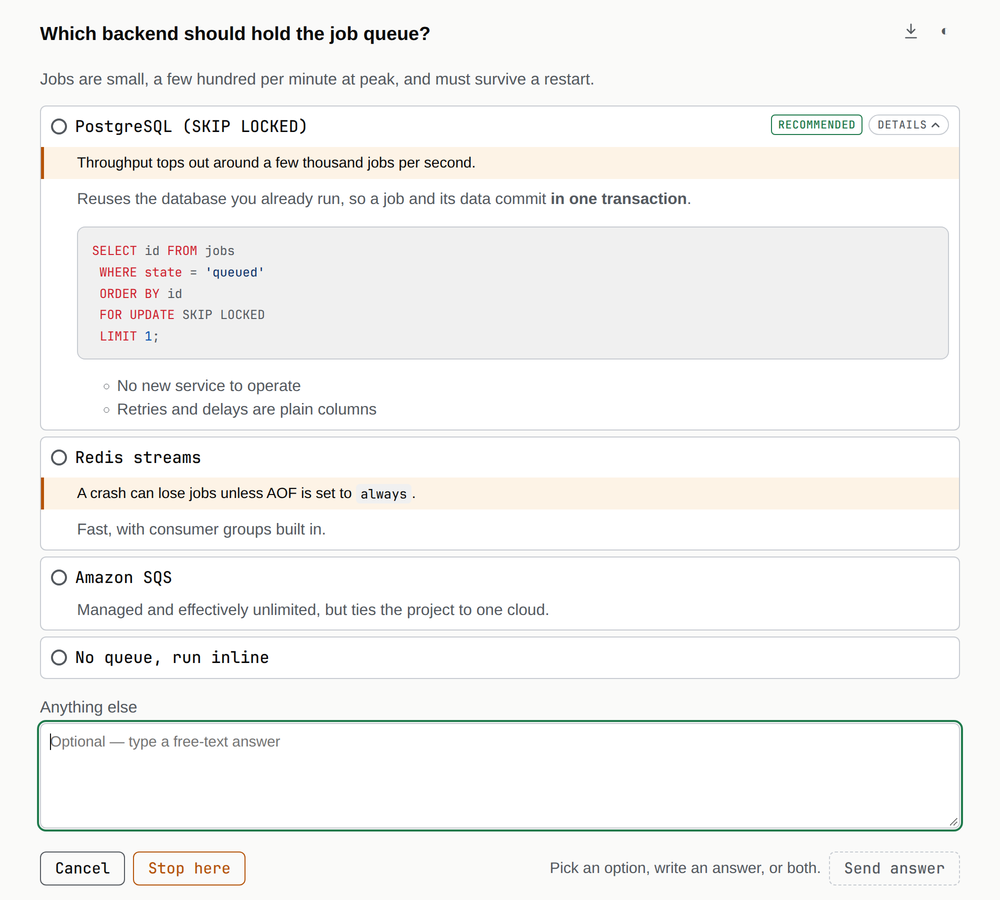

# text-wall-breaker

An MCP server that asks the user a question, shows them a result, or has them review a
diff, in a browser page.

A wall of unformatted text is hard to read, and HTML is the tool for fixing that. But
hand-writing a page per question doesn't scale, and a model generating HTML inline tends
to look it — inconsistent, slow to produce, obviously AI-written. `text-wall-breaker` covers
the common cases — options with explanations, images, long text — with one well-designed
page instead, so neither cost has to be paid per question.

Claude Code's built-in AskUserQuestion renders inside the terminal panel: at most four
options, plain-text previews, no images. `text-wall-breaker` opens a real page on the desktop
instead, so a question can carry any number of options, a Markdown body per option, and
images.

<picture>
  <source media="(prefers-color-scheme: dark)" srcset="docs/images/ask-dark.png">
  
</picture>

## Tools

The server provides five tools. The table gives what each waits for and what it is for.
The agent calls `live` in a loop during a live session that a `review` or an `ask`
started.

| Tool | Waits for | Use it for |
| --- | --- | --- |
| [`ask`](docs/ask-tool.md) | the user's answer | a question with options, free text, rankings or several steps |
| [`show`](docs/show-tool.md) (prototype) | nothing, or an Acknowledge click | a report or comparison the user only reads |
| [`show_status`](docs/show-tool.md#show_status) | nothing | checking whether the last `show` was acknowledged |
| [`review`](docs/review-tool.md) | the user's comments | line-anchored comments on a diff |
| [`live`](docs/live-tool.md) | the user's next message | a live session that a `review` or an `ask` started |

Three more documents cover what applies to several tools and to the project:

- [Markdown subset](docs/markdown-subset.md): what a page renders and how images and links resolve.
- [How a call works](docs/how-a-call-works.md): the loopback listener, the shared tab and timeouts.
- [Developing](docs/developing.md): running the tests and the checks before going public.

## Installing

Both ways below run it with [uv](https://docs.astral.sh/uv/), which also fetches a fitting
Python: 3.13.6 or newer, since older releases have CVE-2025-6069 (a slowdown in the HTML
parser that renders `review`'s AsciiDoc view). A checkout runs on the version in
`.python-version`, the newest stable one. `review` with `repo` needs git 2.40 or newer.

Register it with Claude Code, from a checkout of this repository:

```bash
claude mcp add text-wall-breaker -- uv run --directory /path/to/text-wall-breaker text-wall-breaker-mcp
```

Or straight from the Git repository, with no checkout (a tag pins a release):

```bash
claude mcp add text-wall-breaker \
  -- uvx --from git+ssh://git@github.com/leon-becker-secforge/text-wall-breaker.git@v0.22.0 text-wall-breaker-mcp
```

It is not published to PyPI: the name `text-wall-breaker` is not reserved there for this
project.

The server refuses to start on a host it cannot show a page on, and exits with status 2
and a message on stderr instead. That surfaces as a connection error in the client
rather than as a failure inside the first question asked. What it opens pages with, and
so what it checks for at launch, depends on the platform:

| Platform | Opener | Refuses to start when |
| --- | --- | --- |
| Linux desktop | `webbrowser`, then `xdg-open` | `xdg-open` is missing, or neither `DISPLAY` nor `WAYLAND_DISPLAY` is set |
| WSL | `wslview` if installed, else `explorer.exe` | `wslview` is missing, and `explorer.exe` is neither on `PATH` nor at `/mnt/c/Windows/explorer.exe` (Windows interop off) |
| macOS | `open` | `open` is missing |
| Windows | `os.startfile` | never |

Under WSL, pages open in the Windows browser, not a Linux one inside WSLg, and no
display variable is needed. With the `explorer.exe` fallback, a one-shot page's file is
first translated to its `\\wsl.localhost\...` path with `wslpath -w`; explorer.exe's exit
status is ignored, since it reports 1 even on success, so a page that never opened
shows up as `not_delivered` instead. Any other status, or any output on stderr, is
written to the server's stderr, which the client keeps in its MCP log. With
`appendWindowsPath = false` in `/etc/wsl.conf` the Windows directories are not on `PATH`
although interop works; the server then looks for `/mnt/c/Windows/explorer.exe` itself.
`file://` images on such a one-shot page still
point at Linux paths the Windows browser can't read; pages on the shared tab load
images over the loopback listener and are unaffected.

### Opener override

Set `TEXT_WALL_BREAKER_OPENER` to a command line to open pages with that instead, for a
setup the table above gets wrong. The page's path or URL is appended as the last
argument; the command is split shell-style but not run through a shell. An override
also skips the display check. At launch, the first word must resolve on `PATH` (or be
a path to an executable), otherwise the server refuses to start:

An override gets a one-shot page (used when the shared tab is busy) as a plain file path,
without the `wslpath -w` translation the built-in WSL opener applies. Under WSL, an override
that hands the target to a Windows program therefore opens such a page only if the program
understands Linux paths. Pages on the shared tab are loopback URLs and are unaffected.

```bash
claude mcp add text-wall-breaker --env TEXT_WALL_BREAKER_OPENER="firefox --new-tab" -- uv run --directory /path/to/text-wall-breaker text-wall-breaker-mcp
```

### Accent colour

The page's accent — the selected-option border and tint, the submit/Acknowledge button,
focus rings — defaults to green, for `ask`, `show`, and `review` alike. Set
`TEXT_WALL_BREAKER_ACCENT` to a `#rrggbb` hex colour to use something else instead, in both
light and dark theme:

```bash
claude mcp add text-wall-breaker --env TEXT_WALL_BREAKER_ACCENT=#2563eb -- uv run --directory /path/to/text-wall-breaker text-wall-breaker-mcp
```

The text colour on top of the accent (e.g. the submit button's label) and the tint
behind a selected option are derived from the colour given, not configured separately.
An unset or invalid value falls back to the default green; an invalid one also makes
the server refuse to start, for the same reason as the opener checks
above — surfaced once at launch rather than as a page that silently ignored it.
